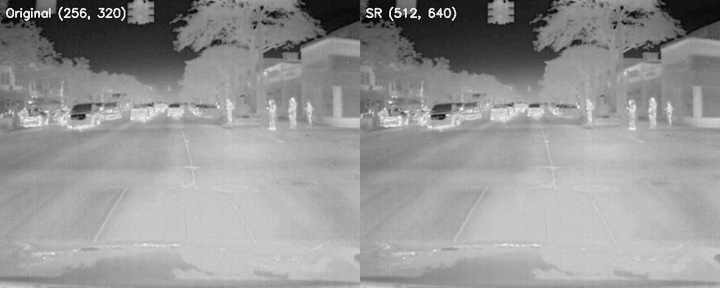
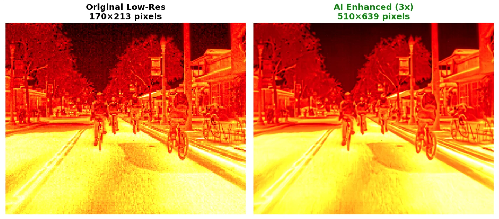
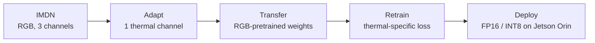

# Thermal super-resolution

I adapted an RGB super-resolution network to single-channel thermal imagery, so a cheap low-resolution thermal camera on a drone or ground robot can give the rest of the perception stack a sharper frame, in real time, on the hardware the vehicle carries.

[](requirements.txt)
[](https://pytorch.org/)



*Left: the original 256 × 320 thermal frame. Right: the ×2 output, 512 × 640.*

## What it is

Thermal sensors see what ordinary cameras miss, in the dark and in low-contrast scenes, but their price climbs steeply with resolution. Super-resolution spends compute instead: recover a more useful image from the sensor you already have.

The catch is that an RGB-trained model has learned the statistics of photographs. It is rewarded for inventing texture and edges that may mean nothing in a heat image, and a sharp but invented gradient can be worse than a soft one if a detector downstream treats it as evidence. So I took an Information Multi-Distillation Network (IMDN), cut it down to one channel, started from RGB-pretrained weights, and retrained it with a thermal-specific objective that pays attention to the gradients, contrast and structure that belong to heat imagery.

## Results

| Scale | PSNR | SSIM |
|:---:|---:|---:|
| ×2 | 34.2 dB | 0.840 |
| ×3 | 31.0 dB | 0.757 |
| ×4 | 29.6 dB | 0.713 |

| Hardware | Speed |
|---|---|
| RTX 3070 laptop GPU | ~130 FPS at ×2, ~60 FPS at ×4 |
| NVIDIA Jetson Orin, onboard a drone (FP16 / INT8) | 20–30 FPS |

A thermal camera delivers at most about 20 frames a second, so on the Jetson that is real time with room left for a detector beside it. I always give a speed figure together with the hardware that produced it: "real time" is a property of the whole pipeline on named hardware at a named input size, not of a model file.

The quality numbers are dataset-specific, and the task gets less constrained as the scale grows. They don't replace looking at the frames:




## How it works



1. **Adapt.** The IMDN layers go from three RGB channels to one thermal channel (`IMDN(in_nc=1, out_nc=1)`), to match what the sensor actually measures.
2. **Transfer.** Thermal training data is scarce, so weights pretrained on RGB give the model a useful start.
3. **Retrain.** A multi-component thermal-specific loss moves the model towards heat-relevant gradients and contrast instead of photographic texture. Training used FLIR ADAS v2 plus custom-curated thermal data, with AdamW and cosine annealing.
4. **Deploy.** Inference moves to FP16 and INT8 and is measured as a complete pipeline, not a bare model: acquisition, preprocessing, inference and display each run on their own thread, and every stage is timed.

## Quick start

The trained checkpoints are not committed (`checkpoints/` is git-ignored), so the scripts expect a model at `checkpoints/_x<scale>/thermal_best.pth`.

```bash
git clone https://github.com/Kronbii/thermal-super-resolution.git
cd thermal-super-resolution
pip install -r requirements.txt
pip install tqdm            # used by the video script
```

The scripts are configured by constants at the top of each file, not by command-line flags.

**Turn a folder of thermal frames into comparison videos.** Set `INPUT_FRAMES_DIR` and `SCALE` (2, 3 or 4) in `convert-LR-HR-video.py`, then:

```bash
python convert-LR-HR-video.py
```

It downsamples each frame, super-resolves it, and writes a low-resolution video, a super-resolved video and a side-by-side comparison to a timestamped `results/video_processing_<time>` folder. The demo videos in `results/_x2_demo/` and `results/_x3_demo/` are side-by-side comparisons of this kind.

**Measure streaming throughput.** Set `DATA_DIR`, `MODEL_PATH` and `SCALE` at the top of a `threaded_display_*.py` script, then:

```bash
python threaded_display_60fps.py
```

It runs a threaded pipeline with mixed precision, shows the output, and prints a per-stage timing summary and the overall throughput when you stop it with `q` or Ctrl+C.

`utils/png2npy.py` converts PNG datasets to `.npy`, and `FLOPs/` counts model FLOPs and parameters.

## Repository layout

```
model/                       IMDN architecture and blocks (thermal: in_nc=1, out_nc=1)
data/                        dataset loaders for single-channel and RGB images
RGB/                         the RGB IMDN training and test scripts the model started from
FLOPs/                       FLOPs and parameter counting
utils/png2npy.py             dataset conversion
convert-LR-HR-video.py       frames -> LR, SR and side-by-side comparison videos
threaded_display_*.py        threaded real-time inference and throughput measurement
test-data/                   sample thermal frames
results/                     sample ×2 and ×3 comparisons, showcase images and demo videos
```

## Limits and what's next

- The PSNR and SSIM figures are specific to the evaluation data, and become less constrained at larger scales.
- Speeds belong to the hardware and input size they were measured on; a different GPU or frame size will give different numbers.
- The next real test is task-based: does a detector find more of the objects that matter on super-resolved frames, does measurement stay stable, and where does reconstruction create false confidence? Better-looking frames are not the goal; better perception is.

## Links

- Project page: [ramikronbi.com/projects/thermal-super-resolution](https://ramikronbi.com/projects/thermal-super-resolution)
- Write-up: [Adapting super-resolution to thermal imagery](https://ramikronbi.com/writing/adapting-super-resolution-to-thermal-imagery)

The network is IMDN, the Information Multi-Distillation Network, adapted here for thermal data. Released under the MIT License, see [LICENSE](LICENSE).

Built by Rami Kronbi — [ramikronbi.com](https://ramikronbi.com)
