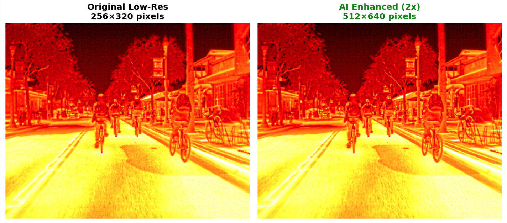
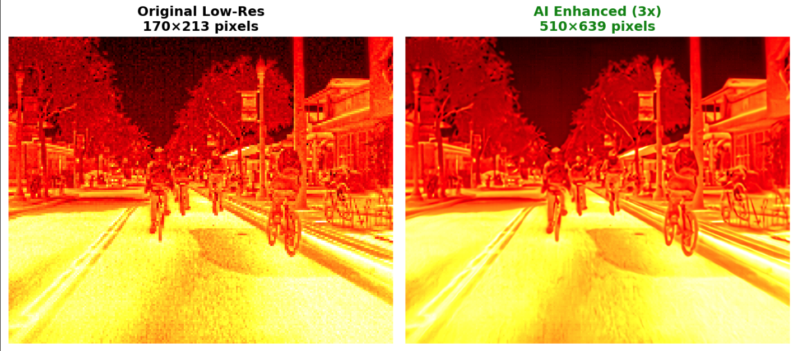

# Thermal Super-Resolution with IMDN

[](https://github.com/Kronbii/thermal-super-resolution/actions/workflows/ci.yml)
[](LICENSE)

Super-resolution for single-channel thermal images at x2, x3 and x4. The model
is IMDN ([Hui et al., 2019](https://github.com/Zheng222/IMDN)), fine-tuned from
its authors' RGB weights on thermal frames from FLIR ADAS v2. Every number in
this README comes from one benchmark script (`python -m benchmark.run`) run
under one written protocol (`benchmark/protocol.py`). The script
`python -m benchmark.report` copies the numbers in from
`results/benchmark.json`, and CI fails if the two disagree.

Tested with Python 3.12, PyTorch 2.9.1 and CUDA 12.8.

## Results

<!-- BENCHMARK:HEADLINE:START -->
Measured with `python -m benchmark.run` (protocol v1.0): at x2 on the 17 frames in `test-data/`, the fine-tuned model reaches **32.56 dB PSNR / 0.8469 SSIM**, against 31.81 dB / 0.8291 for bicubic interpolation. One 320x256 -> 640x512 frame takes **14.22 ms median** for the forward pass with fp16 autocast on an NVIDIA GeForce RTX 3070 Laptop GPU (70 FPS; 14.60 ms, 69 FPS including host-device copies and conversion); in fp32 it takes 21.90 ms (46 FPS).
<!-- BENCHMARK:HEADLINE:END -->

### Quality

Every method sees the same LR input. The input is made from the reference
image with OpenCV bicubic downscaling, the same operation that produced the
training data.

<!-- BENCHMARK:QUALITY:START -->
**test-data/ (17 FLIR ADAS v2 frames, 320x256)**, n = 17. The 'HR' reference here is itself a 2x bicubic downscale of the native 640x512 frame, so this set measures the operator on 320x256 content, not on native-resolution frames.

| Scale | Method | PSNR (dB) | SSIM | PSNR gain vs bicubic (dB) |
|:---:|:---|---:|---:|---:|
| x2 | Bicubic (OpenCV) | 31.81 | 0.8291 | - |
| x2 | IMDN, upstream RGB weights | 29.17 | 0.7868 | -2.63 |
| x2 | **IMDN, thermal fine-tune (this repo)** | 32.56 | 0.8469 | +0.76 |
| x3 | Bicubic (OpenCV) | 27.99 | 0.6937 | - |
| x3 | IMDN, upstream RGB weights | 25.30 | 0.6280 | -2.68 |
| x3 | **IMDN, thermal fine-tune (this repo)** | 28.94 | 0.7342 | +0.95 |
| x4 | Bicubic (OpenCV) | 27.09 | 0.6522 | - |
| x4 | IMDN, upstream RGB weights | 24.26 | 0.5979 | -2.84 |
| x4 | **IMDN, thermal fine-tune (this repo)** | 27.87 | 0.6816 | +0.78 |

Thermal model with fp16 autocast: PSNR less than 0.001 dB from fp32 at every scale.

**TNO Image Fusion Dataset, thermal band (51 images, other sensors)**, n = 51. Native-resolution thermal images from cameras other than the one the model was trained on: a generalisation check, not an in-distribution test.

| Scale | Method | PSNR (dB) | SSIM | PSNR gain vs bicubic (dB) |
|:---:|:---|---:|---:|---:|
| x2 | Bicubic (OpenCV) | 41.10 | 0.9676 | - |
| x2 | IMDN, upstream RGB weights | 38.20 | 0.9432 | -2.89 |
| x2 | **IMDN, thermal fine-tune (this repo)** | 42.00 | 0.9649 | +0.91 |
| x3 | Bicubic (OpenCV) | 36.12 | 0.9151 | - |
| x3 | IMDN, upstream RGB weights | 33.26 | 0.8799 | -2.86 |
| x3 | **IMDN, thermal fine-tune (this repo)** | 36.52 | 0.9134 | +0.40 |
| x4 | Bicubic (OpenCV) | 33.79 | 0.8783 | - |
| x4 | IMDN, upstream RGB weights | 30.17 | 0.8272 | -3.63 |
| x4 | **IMDN, thermal fine-tune (this repo)** | 34.49 | 0.8863 | +0.70 |

Thermal model with fp16 autocast: PSNR within 0.002 dB from fp32 at every scale.
<!-- BENCHMARK:QUALITY:END -->

### Speed

<!-- BENCHMARK:SPEED:START -->
| Scale | Input -> output (W x H) | Precision | Model latency median / p95 (ms) | Trial medians min-max (ms) | Model FPS | End-to-end median / p95 (ms) | End-to-end FPS |
|:---:|:---:|:---:|---:|---:|---:|---:|---:|
| x2 | 320x256 -> 640x512 | fp32 | 21.90 / 22.26 | 21.50-22.08 | 46 | 22.29 / 22.50 | 45 |
| x2 | 320x256 -> 640x512 | fp16 | 14.22 / 14.33 | 13.87-14.26 | 70 | 14.60 / 14.75 | 69 |
| x3 | 213x170 -> 639x510 | fp32 | 10.59 / 10.74 | 10.32-10.70 | 94 | 10.77 / 10.88 | 93 |
| x3 | 213x170 -> 639x510 | fp16 | 6.96 / 7.03 | 6.74-7.01 | 144 | 7.31 / 7.47 | 137 |
| x4 | 160x128 -> 640x512 | fp32 | 5.84 / 6.16 | 5.67-6.15 | 171 | 6.00 / 6.31 | 167 |
| x4 | 160x128 -> 640x512 | fp16 | 3.78 / 4.07 | 3.66-4.05 | 265 | 4.46 / 4.79 | 224 |

Batch 1. 5 interleaved trials x (50 warm-up + 300 timed iterations), samples pooled; `torch.cuda.synchronize()` around every timed call, FPS = 1000 / median. *Model latency*: forward pass only, input already on the GPU. *End-to-end*: uint8 frame in host memory to uint8 frame in host memory (conversion, copies, forward, rounding). fp32 has TF32 disabled; fp16 is `torch.autocast(float16)` with float32 weights. Plain PyTorch eager mode (no TensorRT, CUDA graphs or torch.compile).

Hardware: NVIDIA GeForce RTX 3070 Laptop GPU (8.19 GB), driver 580.173.02, CUDA 12.8, cuDNN 9.10.2, PyTorch 2.9.1+cu128, Python 3.12.3.

Conditions: GPU at 70-87 °C and SM clock 1440-1710 MHz (max 2100 MHz) at the end of the trials, 1-min CPU load average 0.8-3.2. Trials started at 38-60 °C with CPU load average 0.3-3.9. Treat the trial spread as the uncertainty of these timings.
<!-- BENCHMARK:SPEED:END -->

### Degradation sensitivity

<!-- BENCHMARK:ABLATION:START -->
Same frames, same methods, but the LR input is made with an anti-aliased bicubic downscale (PIL, MATLAB-like) instead of the OpenCV bicubic used for training. This is a sensitivity check, not the headline protocol.

| Scale | Method | PSNR (dB), OpenCV LR | PSNR (dB), anti-aliased LR |
|:---:|:---|---:|---:|
| x2 | Bicubic (OpenCV) | 31.81 | 31.80 |
| x2 | IMDN, upstream RGB weights | 29.17 | 33.12 |
| x2 | **IMDN, thermal fine-tune (this repo)** | 32.56 | 32.26 |
| x3 | Bicubic (OpenCV) | 27.99 | 29.66 |
| x3 | IMDN, upstream RGB weights | 25.30 | 30.60 |
| x3 | **IMDN, thermal fine-tune (this repo)** | 28.94 | 29.86 |
| x4 | Bicubic (OpenCV) | 27.09 | 28.52 |
| x4 | IMDN, upstream RGB weights | 24.26 | 29.29 |
| x4 | **IMDN, thermal fine-tune (this repo)** | 27.87 | 28.57 |
<!-- BENCHMARK:ABLATION:END -->

<!-- BENCHMARK:PROVENANCE:START -->
Protocol v1.0 (`benchmark/protocol.py`), `python -m benchmark.run --scale 2 3 4 --sets repo17 tno-lwir`, commit `a4ea485010`, 2026-10-10T12:36:31Z.
<!-- BENCHMARK:PROVENANCE:END -->

Full output, including per-image values and weight digests:
[`results/benchmark.md`](results/benchmark.md) and
[`results/benchmark.json`](results/benchmark.json).

### What changed

Earlier versions of this README made claims that the repository could not
support. The benchmark numbers above replace them, including where they are
lower.

<!-- BENCHMARK:CHANGED:START -->
- **Quality.** On the 17 committed frames the x2 model is +0.76 dB PSNR above bicubic (32.56 vs 31.81 dB). The old table implied about +10 dB, against a bicubic figure (24.2 dB) that has no traceable source. The old 34.2 dB came from a validation split that is not published and also selected the checkpoint; it is no longer quoted.
- **Speed.** Timed with GPU synchronisation, x2 (320x256 -> 640x512) runs at 46 FPS in fp32 and 70 FPS with fp16 autocast on an RTX 3070 Laptop GPU, not 229-271 FPS: the old figures timed kernel launches, not GPU work.
- **Removed** as unsupported: ~~First thermal super-resolution system~~, ~~New SOTA for thermal SR~~, ~~15x faster than competitors~~, ~~First real-time 4x thermal SR~~, ~~Breakthrough method~~, ~~novel IMDN architecture~~, the 40x/24x parameter-reduction claims and the ESRGAN comparison row (never run here). Full list: [docs/claims-audit.md](docs/claims-audit.md).
<!-- BENCHMARK:CHANGED:END -->

## Qualitative examples

These before/after images were made during development from validation-split
frames. They illustrate the output and are not part of the benchmark.

| Example | Scale |
|:---:|:---:|
|  | 2x |
|  | 3x |

## Benchmark protocol

`benchmark/protocol.py` defines the protocol in one place, and a copy of it is
embedded in every results file. In short:

- **Test sets.**
  - `repo17` (default): the 17 frames in `test-data/`, 320x256, from FLIR ADAS
    v2 (see [test-data/README.md](test-data/README.md)). These frames are
    themselves 2x downscales of the native 640x512 frames, so this set measures
    the model on 320x256 content. They come from the validation split, which
    was held out from training but used to choose the checkpoint.
  - `tno-lwir` (optional): 51 single-band thermal images from the
    [TNO Image Fusion Dataset](https://doi.org/10.6084/m9.figshare.1008029)
    (CC BY 4.0, credit TNO). They were recorded with other cameras than the
    training data, so this set is a generalisation check. The images are
    downloaded on demand, verified by SHA-256 and never committed.
  - `flir-video-test` (optional, user-supplied): FLIR ADAS v2
    `video_thermal_test` at native 640x512. The data preparation never read
    this split, so it is the proper in-distribution test. It is not run here,
    because the dataset requires accepting FLIR's terms.
- **LR input.** Grayscale uint8, cropped from the top-left to a multiple of the
  scale, then downscaled with `cv2.resize(INTER_CUBIC)`. There is no blur and
  no noise, and this matches `prepare-train-data.ipynb`.
- **Model I/O.** The input is uint8 / 255. The output is clamped to [0, 1],
  multiplied by 255, rounded and stored as uint8. Metrics are computed on that
  uint8 image, as a saved output would be.
- **Metrics.** Single channel, data range 255, with `scale` pixels cropped from
  every border. PSNR is 10·log10(255²/MSE). SSIM follows Wang et al. (2004):
  11x11 Gaussian window, σ = 1.5, K1 = 0.01, K2 = 0.03, mean over the valid
  region. Each value is the mean of per-image values. The implementation is
  checked against scikit-image in `tests/test_metrics.py`.
- **Baselines.** OpenCV bicubic upscaling, and the upstream IMDN RGB weights
  with no thermal fine-tuning. For the upstream model the gray input is
  replicated to 3 channels and the output channels are averaged.
- **Speed.** Batch 1. Output is about 640x512, the native resolution of the
  training camera: the inputs are 320x256 (x2), 213x170 (x3) and 160x128 (x4).
  Each configuration gets 5 interleaved trials of 50 warm-up and 300 timed
  iterations, with `torch.cuda.synchronize()` around each timed call. The
  table reports the median, p95 and spread of trial medians, and FPS =
  1000 / median. *Model latency* is the forward pass only. *End-to-end* runs
  from a uint8 frame in host memory to a uint8 frame in host memory. fp32 runs
  with TF32 disabled. fp16 uses `torch.autocast` with float32 weights; pure
  `model.half()` overflows in the channel attention and outputs NaN. Before
  each trial the run waits, for up to 5 minutes, until the GPU has cooled to
  60 °C and the 1-minute CPU load average is at most 4. The development
  laptop is shared with other work. The run records the GPU name, driver,
  CUDA, cuDNN and PyTorch versions, plus the temperatures, clocks and CPU
  load during timing.
- **Determinism.** Fixed seeds and deterministic cuDNN kernels for the quality
  pass, so a rerun on the same machine reproduces the quality numbers exactly
  (checked in `tests/test_benchmark_quick.py`).

**Limitations.**
- The default set is small (17 frames from 3 videos), and its references are
  downscaled images.
- The images that selected the checkpoint come from the same split as these
  frames.
- The model is specialised to the OpenCV bicubic degradation; see
  "Degradation sensitivity" above.
- Timings come from a laptop GPU. They vary with temperature, power state and
  other load on the machine, as the spread column shows.
- PSNR and SSIM do not measure perceptual quality or usefulness for downstream
  detection.

## Reproduce

```bash
git clone https://github.com/Kronbii/thermal-super-resolution.git
cd thermal-super-resolution
python3 -m venv .venv-bench && source .venv-bench/bin/activate
pip install -r benchmark/requirements.txt      # CPU only: install torch from the CPU index first (see file)

pytest                                         # metrics vs scikit-image, model, quick end-to-end run
python -m benchmark.run --scale 2 3 4          # repo17, quality + speed -> results/benchmark.{json,md}
python -m benchmark.data --fetch tno-lwir      # optional: 117 MB, checksum-verified, CC BY 4.0
python -m benchmark.run --scale 2 3 4 --sets repo17 tno-lwir
python -m benchmark.report                     # rewrite the generated blocks in README and docs
```

**Weights.** The scripts expect the following files under `checkpoints/`:

- The fine-tuned models: `checkpoints/_x2/thermal_best.pth`,
  `checkpoints/_x3/thermal_best.pth` and `checkpoints/x4/thermal_best.pth`.
  **They are not in git.** Until they are published, third parties can
  reproduce the pipeline (tests, CI smoke run) but not the model numbers.
- The upstream baseline weights:
  `checkpoints/pretrained/IMDN_x{2,3,4}.pth`, available from
  [Zheng222/IMDN](https://github.com/Zheng222/IMDN/tree/master/checkpoints).

`results/benchmark.md` lists a state-dict SHA-256 for every weight file
evaluated, so a rerun can be checked against the same weights.
`python -m benchmark.export_weights` writes slim, state-dict-only copies
(about 2.8 MB each, with a `SHA256SUMS` file) to the git-ignored
`dist/weights/`, ready to attach to a release. Placed in `checkpoints/`, the
benchmark picks them up by name (`imdn_thermal_x{2,3,4}.pth`). Without
weights, `python -m benchmark.run --quick --device cpu --random-weights`
exercises the whole pipeline; its numbers are meaningless.

## Model and training

- **Architecture.** IMDN with 6 information multi-distillation blocks and 64
  features, 1-channel input and output, and a pixel-shuffle upsampler.
  688,636 / 691,521 / 695,560 parameters for x2 / x3 / x4, which is 2.75 MB of
  fp32 weights.
- **Initialisation.** From the upstream DIV2K weights. The first convolution
  and the upsampler weights are averaged over the RGB channels.
- **Data.** FLIR ADAS v2 thermal (`images_thermal_train` + `images_thermal_val`,
  pooled and split 90/10 with seed 42: 10,697 train / 1,189 validation). LR
  inputs come from OpenCV bicubic downscaling.
- **Loss.** L1 + 0.08 x Sobel-gradient L1 + 0.03 x local-variance L1. The
  effect of the extra terms has not been measured separately.
- **Optimisation.** AdamW (lr 2.2e-5, weight decay 1.2e-4) with cosine
  annealing, 60 epochs. Mixed precision, 144 px patches, batch 10 with 5-step
  accumulation, and the backbone frozen for the first 10 epochs. Trained on an
  RTX 3070 Laptop GPU (8 GB). These are the settings saved in the notebook,
  which was last run for x3. The x4 checkpoints show 100 epochs with
  validation every 5; its other settings were not recorded.
- **Checkpoint.** The checkpoint with the best validation PSNR, checked every
  3 epochs (x4: every 5). The selected epochs are 57 (x2), 54 (x3) and 90 (x4).

The data-preparation, training and evaluation notebooks are kept in
`scripts/`, which is currently not under version control.

## Project structure

```
thermal-super-resolution/
├── benchmark/              # protocol, metrics, runner, report (python -m benchmark.run)
│   └── manifests/          # SHA-256 lists for the test sets
├── tests/                  # pytest suite (runs on CPU in CI)
├── results/benchmark.*     # benchmark output (JSON + Markdown)
├── docs/                   # claims audit, portfolio summary, figures
├── model/                  # IMDN implementation (upstream, unchanged)
├── data/                   # dataset loaders used for training
├── test-data/              # 17 thermal frames used by the benchmark and demos
├── threaded_display_*.py   # real-time streaming demos
└── convert-LR-HR-video.py  # side-by-side comparison video
```

## Licence and data

- **Code.** This repository's code is under the MIT licence ([LICENSE](LICENSE)).
- **IMDN.** `model/`, parts of `data/`, `RGB/`, `FLOPs/` and the pretrained
  weights come from [Zheng222/IMDN](https://github.com/Zheng222/IMDN), which
  declares no licence.
- **Frames.** The frames in `test-data/` are derived from FLIR ADAS v2, under
  the Teledyne FLIR Non-Commercial Image Dataset License Agreement. They are
  not MIT-licensed; see [test-data/README.md](test-data/README.md).
- **TNO.** The TNO images are CC BY 4.0. They are downloaded, not
  redistributed.

Possible uses, none evaluated: higher-resolution thermal streams for driving
scenes, the only domain the model was trained on.

## Citation

```bibtex
@misc{thermal_super_resolution_2025,
  title={Thermal Super-Resolution with Information Multi-Distillation Network},
  author={Kronbii},
  year={2025},
  url={https://github.com/Kronbii/thermal-super-resolution}
}

@inproceedings{hui2019imdn,
  title={Lightweight Image Super-Resolution with Information Multi-distillation Network},
  author={Hui, Zheng and Gao, Xinbo and Yang, Yunchu and Wang, Xiumei},
  booktitle={Proceedings of the 27th ACM International Conference on Multimedia},
  pages={2024--2032},
  year={2019}
}
```
